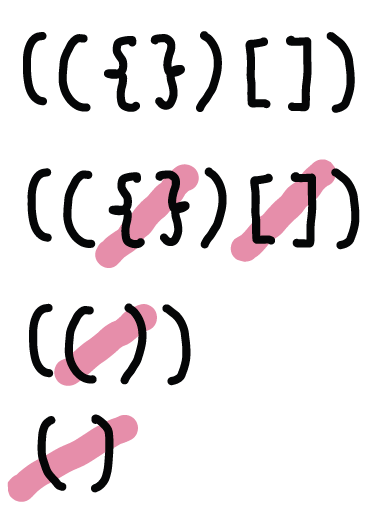
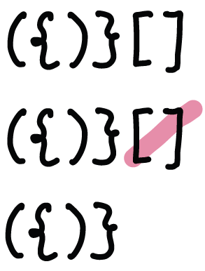

# 20. Valid Parentheses

**Difficulty** : Easy

**Link** : [https://leetcode.com/problems/valid-parentheses/](https://leetcode.com/problems/valid-parentheses/)

---
### Question
> Given a string s containing just the characters '(', ')', '{', '}', '[' and ']', determine if the input string is valid.
>
> An input string is valid if:
>
> Open brackets must be closed by the same type of brackets.
> Open brackets must be closed in the correct order.
> Every close bracket has a corresponding open bracket of the same type.

### Solution Concept
**Valid**

`It will return true when it's empty`

**Invalid**

`No more complete set of parentheses to remove`
`Return false when it's not empty`