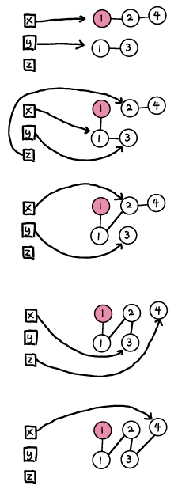

# 21. Merge Two Sorted Lists

**Difficulty** : Easy

**Link** : [https://leetcode.com/problems/merge-two-sorted-lists/](https://leetcode.com/problems/merge-two-sorted-lists/)

---
### Question
> You are given the heads of two sorted linked lists list1 and list2.
>
>Merge the two lists into one sorted list. The list should be made by splicing together the nodes of the first two lists.
>
>Return the head of the merged linked list.

### Solution Concept
